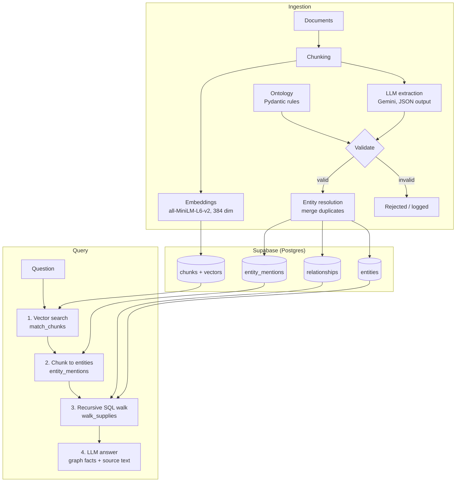

# Supply Chain Graph RAG (Supabase + pgvector + Ontology)

A small Graph RAG system that answers **multi-hop supply chain questions** which plain vector RAG gets wrong. Everything lives in one Postgres database (Supabase): vector embeddings, the knowledge graph, and the links between them.

## The problem

Plain vector RAG finds text that *looks like* the question. It cannot follow relationships across documents.

> **Question:** "Which companies are upstream suppliers of the company that had a brake safety incident?"

The correct chain is `Zenith Motors <- BuildCo <- Acme Steel`. Acme Steel's document never mentions Zenith or the incident, so vector search never retrieves it.

## Before vs after

| | Vector RAG (baseline) | Graph RAG |
|---|---|---|
| Zenith's direct suppliers | 2 of 3 found (Orion Chemicals missing) | All 3 found |
| Second-tier supplier (Acme Steel) | **Missing** | **Found, with the full chain** |
| Direct vs indirect suppliers | Not distinguished | Hop 1 vs hop 2 |
| Downstream impact ("if Acme stops...") | Cannot follow links | Full chain to Zenith Motors and Falcon Aerospace |

Raw outputs: `baseline_results.txt` and `graphrag_results.txt`.

## Architecture



## Tech stack

- **Database:** Supabase (Postgres) with `pgvector`, Row Level Security enabled
- **Embeddings:** `sentence-transformers` (`all-MiniLM-L6-v2`), free and local
- **LLM:** Google Gemini (extraction and answer generation)
- **Validation:** Pydantic models that enforce the ontology
- **Graph traversal:** recursive SQL (`WITH RECURSIVE`), no separate graph database
- **Language:** Python

## Ontology

**Entity types:** `Company`, `Product`, `Location`, `Incident`

| Relationship | From -> To | Meaning |
|---|---|---|
| `SUPPLIES` | Company -> Company | Source provides goods to target |
| `MANUFACTURES` | Company -> Product | Company makes the product |
| `LOCATED_IN` | Company -> Location | HQ or factory location |
| `HAD_INCIDENT` | Company -> Incident | Company was affected by the incident |
| `SHIPS_FOR` | Company -> Company | Logistics company ships for the target |

Design decisions:

- **One direction only.** "X buys from Y" is stored as `(Y) SUPPLIES (X)`. There is no `BUYS_FROM`, so one fact has one representation.
- **Details live in properties.** The supplied product is a property on the `SUPPLIES` edge, and incident details (date, kind, cause) are properties on the `Incident` node. This keeps the ontology small and extraction accurate.
- **The ontology is a gatekeeper.** Every LLM output is validated. Unknown relationship types and wrong entity types are rejected instead of entering the graph.

## How it works

1. **Ingest** (`ingest.py`): split documents into chunks, embed them, store them in `chunks`.
2. **Extract** (`extract.py`): the LLM returns entities and relationships per chunk, with retry and exponential backoff for rate limits. Each item is validated against `ontology.py`.
3. **Build the graph** (`build_graph.py`): entity resolution merges duplicates (normalized name plus type), property keys and values are normalized, parallel edges are merged, and provenance is stored (`chunk_id` on edges, `entity_mentions` for nodes).
4. **Query** (`graph_rag.py`):
   1. Vector search finds the best starting chunk.
   2. `entity_mentions` maps the chunk to graph entities.
   3. A recursive SQL function walks `SUPPLIES` edges up or down, up to 3 hops.
   4. The LLM writes the answer from the graph facts plus the source text.

## Run it

```bash
python -m venv venv
venv\Scripts\activate          # Windows
pip install supabase sentence-transformers google-genai pydantic python-dotenv
```

Create a `.env` file (never commit it):

```
SUPABASE_URL=https://YOUR_PROJECT.supabase.co
SUPABASE_KEY=your_secret_key
GEMINI_API_KEY=your_gemini_key
GEMINI_MODEL=gemini-3.8-flash
```

Run the SQL for the tables, `match_chunks` and `walk_supplies` in the Supabase SQL Editor, then:

```bash
python ingest.py
python extract.py
python build_graph.py
python graph_rag.py
python graph_rag.py "If Acme Steel stops production, which companies are affected downstream?"
```

## Known limitations and next steps

I know where this prototype is weak:

- **Single starting chunk.** The traversal starts from the top-1 vector result. If it is wrong, the walk starts in the wrong place. Next step: use several candidates and rerank.
- **Keyword-based direction.** Up or down is chosen with a regex. Next step: have the LLM parse the question into a structured query (`start`, `direction`, `hops`).
- **Only `SUPPLIES` is traversed.** Questions about locations or incidents ("suppliers in Vietnam") need more query types.
- **Simple entity resolution.** Matching is by normalized name and type, so "Zenith" and "Zenith Motors" would not merge. Next step: embedding similarity or LLM-assisted matching.
- **Property vocabulary is only partly controlled.** Keys and values are normalized in code. A fixed list of allowed keys in the prompt would be stricter.
- **Small demo dataset.** Eight documents. The design is meant to scale, but it has not been tested at volume.
- **No evaluation set yet.** Next step: a set of questions with expected answers to measure precision and recall for vector vs graph.

## Project structure

```
data.py              demo documents
ontology.py          entity/relationship types and validation rules
ingest.py            chunk + embed + store
extract.py           LLM extraction, validated by the ontology
build_graph.py       entity resolution + write graph to Supabase
query.py             vector-only baseline
graph_rag.py         hybrid retrieval: vector + graph + LLM
baseline_results.txt vector RAG output (before)
graphrag_results.txt Graph RAG output (after)
```
